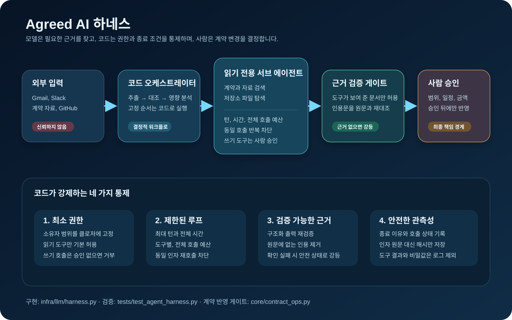

# Agreed AI 하네스 설계와 근거

검증일: 2026-11-16



## 이 구조가 해결하는 문제

Agreed는 고객 대화, 계약 자료, GitHub 코드를 함께 읽습니다. 외부 문서 안의 지시문을
모델이 명령으로 오해하거나, 같은 검색을 반복하거나, 근거가 없는 답을 계약 판단으로
올리면 안 됩니다. 따라서 모델이 자유롭게 결정하는 범위는 **어떤 읽기 도구로 근거를
더 찾을지**로 제한합니다. 업무 순서, 권한, 종료 조건, 근거 검증, 계약 반영은 코드와
사람이 맡습니다.

## 실행 경계

1. `infra/llm/orchestrator.py`와 `infra/llm/solution.py`가 고정된 업무 순서를 실행합니다.
2. `infra/llm/harness.py`의 에이전트는 필요한 읽기 도구만 선택합니다.
3. 사용자 요청과 도구 결과는 `untrusted` 블록으로 구분합니다. 이는 보조 신호이며,
   실제 안전 경계는 최소 권한 도구와 코드 검증입니다.
4. 최대 턴, 전체 시간, 전체 도구 호출, 도구별 호출, 동시 호출에 상한을 둡니다.
5. 같은 도구와 같은 인자의 반복 호출은 인자 해시로 차단합니다.
6. 쓰기 도구는 기본 거부하며, 승인 콜백이 명시적으로 허용한 호출만 실행합니다.
7. 최종 출력은 Pydantic 스키마로 검증하고, 문서 인용은 `core/grounding.py`가 원문과
   다시 대조합니다.
8. 실행 로그에는 종료 이유, 상태, 시간, 인자 해시만 남깁니다. 요청 원문, 도구 결과,
   비밀값은 남기지 않습니다.

## 위험과 근거가 코드로 연결되는 지점

| 위험 또는 요구 | 참고한 근거 | 구현 | 검증 |
|---|---|---|---|
| 에이전트 무한 반복 | OpenAI Agents SDK의 `max_turns`, Anthropic의 stopping condition 권고 | `AgentPolicy.max_turns`, `wall_time_seconds`, 도구별 및 전체 호출 예산 | `test_tool_budget_forces_bounded_conclusion` |
| 과도한 권한 | OWASP LLM06 Excessive Agency의 최소 기능, 최소 권한, 사람 승인 | `ToolRisk`, 읽기 전용 기본값, 쓰기 승인 콜백 | `test_write_tool_fails_closed_without_human_approval`, `test_approved_write_tool_runs_once` |
| 간접 프롬프트 주입 | OWASP LLM06의 오염된 외부 자료와 도구 위험 | 외부 입력 표시, 소유자 범위 고정 도구, 허용 목록, 쓰기 기본 거부 | 중복, 인자, 권한 회귀 테스트 |
| 근거 없는 인용 | NIST AI 600-1의 information integrity와 source traceability | 도구가 보여 준 문서만 허용하고 인용을 원문과 재대조 | `core/grounding.py`, 계약 대조 검증 |
| 도구 인자 오용 | OpenAI HITL 문서의 malformed arguments fail-closed 원칙 | 표준 JSON과 object, required, type, enum, 추가 필드 검증 | `test_invalid_arguments_do_not_reach_tool` |
| 같은 탐색 반복 | 제한된 agent loop와 운영 비용 통제 | 도구명과 정규화 인자의 SHA-256 지문 | `test_duplicate_tool_call_is_blocked_and_trace_has_no_raw_data` |
| 실패 추적과 민감정보 노출의 충돌 | NIST의 accountable, transparent, privacy-enhanced 원칙 | 안전한 실행 요약과 원문 없는 추적 정보 | trace 비밀값 미포함 검사 |

## 논문 패턴을 적용한 범위

- [ReAct](https://arxiv.org/abs/2210.03629)의 외부 행동과 관찰을 번갈아 사용하는 패턴을
  제한된 도구 루프에 적용했습니다. 모델의 내부 추론을 저장하거나 노출하지 않습니다.
- [Corrective RAG](https://arxiv.org/abs/2401.15884)의 검색 결과를 평가하고 잘못된 근거를
  교정하는 발상을 인용 검증과 안전 상태 강등에 적용했습니다. 논문의 학습 모델을
  그대로 재현했다고 주장하지 않습니다.
- [RAGAS](https://arxiv.org/abs/2309.15217)의 faithfulness와 context relevance 관점을
  회귀 시험 항목 설계에 참고했습니다. RAGAS 패키지를 런타임 의존성으로 추가하지
  않았습니다.

## 공식 구현 문서

- [Anthropic, Building effective AI agents](https://www.anthropic.com/research/building-effective-agents):
  예측 가능한 단계는 workflow로 두고, 열린 탐색에만 agent를 사용하며 종료 조건과
  sandbox 검증을 두라는 설계 원칙을 적용했습니다.
- [OpenAI Agents SDK, Running agents](https://openai.github.io/openai-agents-python/running_agents/):
  도구 호출 루프와 최대 턴 개념을 실행 정책에 반영했습니다.
- [OpenAI Agents SDK, Human-in-the-loop](https://openai.github.io/openai-agents-python/human_in_the_loop/):
  민감한 도구를 실행 전에 승인하고 거부 시 실행하지 않는 경계를 반영했습니다.
- [OWASP LLM06:2025 Excessive Agency](https://genai.owasp.org/llmrisk/llm062025-excessive-agency/):
  최소 도구, 최소 기능, 사용자 범위 권한, 고위험 작업 승인을 반영했습니다.
- [NIST AI 600-1](https://nvlpubs.nist.gov/nistpubs/ai/NIST.AI.600-1.pdf):
  출처 추적, 불확실성 표시, 검증 가능한 정보, 사람의 과신 방지를 반영했습니다.

## 재현

```bash
.venv/bin/python -m unittest tests.test_agent_harness -v
.venv/bin/python -m unittest discover -s tests -v
```

`tests/test_agent_harness.py`는 실제 외부 모델을 호출하지 않습니다. provider 응답을
고정해 권한과 루프의 회귀를 재현합니다. 실서비스 모델 품질 평가는 별도의 고정 입력
데이터셋으로 수행해야 하며, 이 테스트 통과를 답변 정확도 보장으로 해석하지 않습니다.
